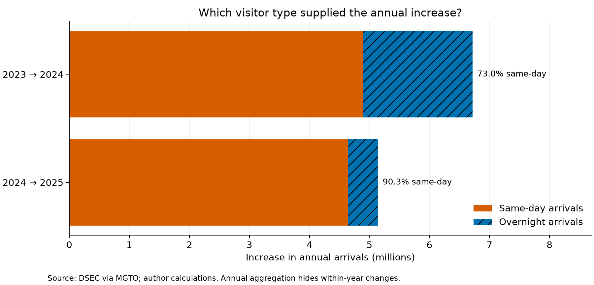

# Macao visitor mix and hotel occupancy (2023–2025)

**Author:** Guanyu Ke · **Status:** ongoing course project.

## Question
Which visitor type supplied the growth in arrivals, and how did hotel occupancy change over the same months?

## Data and usage
DSEC monthly statistics exported from [MGTO Tourism Statistics](https://dataplus.macaotourism.gov.mo/), January 2023–December 2025. Visitor source market = Total; hotel establishments = Total. Definitions: arrivals count trips; same-day visitors do not stay overnight in Macao; overnight visitors are not necessarily hotel guests. Occupancy is occupied rooms relative to available rooms, in percent.

These data are publicly viewable, but public availability is not an unrestricted redistribution license. No open-data license has been established for the MGTO exports. The [MGTO terms](https://www.dst.gov.mo/en/others/footer/terms-conditions.html) retain copyright and describe limited non-commercial use. Raw exports remain local and are excluded from this public repository. No redistribution permission is claimed. Figures here are author-generated, with source attribution, for a non-commercial course project. Verify source terms before reuse.

Download the monthly same-day/overnight visitor-arrivals series with source market Total for 2023–2025 and save it as `data/raw/visitors.csv`. Download monthly Occupancy rate of operating hotel establishments, class Total, for the same period as `data/raw/hotel.csv`. Keep the original English CSV headers. Check `data/SOURCES.json` for the original local-export hashes. A revised source export may have different hashes or values; the notebook checks all 36 matching months and published 2025 arrival totals.

## Reproduce
1. Clone this repository and enter its directory.
2. Obtain the two CSV exports above and place them in `data/raw/`.
3. Create a Python 3.13 environment, then run `python -m pip install -r requirements.txt`.
4. Run `python analysis.py`, or open `macao_tourism_analysis.ipynb` in JupyterLab and Restart Kernel and Run All.
5. Inspect both generated PNG files in `figures/`. Internet access is only needed for dependency installation and obtaining source data.

## Methods and findings
pandas validates a one-to-one year/month merge; annual counts are summed; shares and contributions are calculated from those sums. Matplotlib creates separate aligned monthly panels and a stacked growth decomposition.

- Same-day visitors supplied approximately 90% of the increase from 2024 to 2025.
- Same-day share increased from approximately 50% in 2023 to 59% in 2025.
- The simple mean of monthly hotel occupancy rates rose from approximately 81% to 89%. This is not presented as DSEC's official annual occupancy rate.

The 2025 totals reconcile with [DSEC's release](https://www.gov.mo/en/news/392295/): 40,069,360 total arrivals, including 23,524,943 same-day and 16,544,417 overnight arrivals.

## Visualizations

## Limitations and next steps
Co-movement does not demonstrate causation. Hotel room supply, prices, market mix and a pre-pandemic baseline are missing. The observed occupancy rates cannot establish a capacity ceiling. Add these variables and investigate seasonality next. Raw data require manual retrieval under the source's terms, so reproduction has that external dependency.
